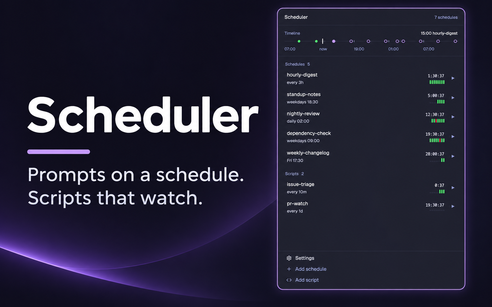
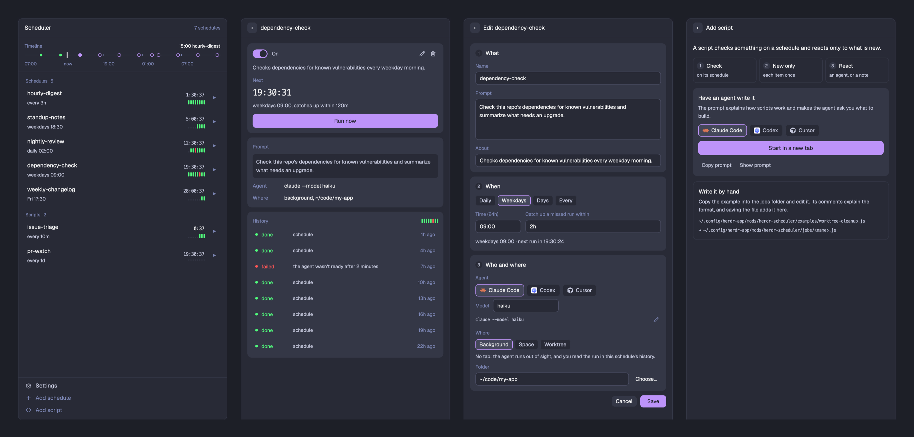

# herdr-scheduler

[Herdr](https://herdr.dev) 앱 안에서 코딩 에이전트에게 정해진 시각에 프롬프트를 보내고, 스크립트로 변화를
지켜봅니다. mod 하나, 스케줄 하나에 JS 파일 하나입니다. 데몬, cron 등록, CLI가 없습니다.

[English](README.md)



실행하는 것은 두 종류입니다.

- **스케줄**은 정해진 시각에 에이전트에게 프롬프트를 보냅니다. 매일 09:00, 평일, 고른 요일, N분마다 중에
  고릅니다. 패널에서 만듭니다.
- **스크립트**는 정해진 주기마다 무언가를 확인하고 새로 생긴 일에만 반응하는 코드입니다. 에이전트를 띄우거나,
  에이전트와 하던 대화를 이어 가거나, 알림만 줍니다. 에이전트가 함께 만들어 줍니다.



## 제공하는 것

- **타임라인.** 지난 6시간의 실행 결과와 앞으로 24시간의 실행 예정을 한 줄로 보여 줍니다.
- **세 가지 실행 위치.** 탭 없이 백그라운드에서, 스페이스의 새 탭에서, 또는 별도의 git 워크트리에서 실행합니다.
  실행이 시작돼도 창의 포커스는 옮겨 가지 않습니다.
- **스케줄 폼.** 무엇을 시킬지, 언제, 누가 어디서 실행할지를 정합니다. 설치된 에이전트와 모델을 고르고,
  입력하는 대로 다음 실행 시각이 보입니다.
- **스크립트용 프롬프트.** 스크립트 추가를 누르면 스크립트의 동작 방식을 설명하고 무엇을 만들지 되묻게 하는
  프롬프트가 나옵니다. 복사하거나, 한 번의 클릭으로 에이전트에게 바로 보낼 수 있습니다.
- **열어 볼 수 있는 이력.** 실행마다 한 줄이 남습니다. 백그라운드 실행은 peek으로 열리고, 탭에서 도는 실행은
  그 pane으로 이동하고, 끝난 실행은 마지막 화면을 패널에서 읽어 줍니다.
- **영어와 한국어.**

## 데몬과 다른 점

mod가 곧 스케줄러라서, **Herdr가 켜져 있고** Scheduler 패널이 지금 레이아웃에 있을 때만 실행됩니다. 패널이
항상 보이는 자리가 아니라면(예: 스택의 한 탭) 실행만 맡는 headless 사본을 하나 더 두세요. 레이아웃에 넣을
한 줄은 [app/RECIPE.md](app/RECIPE.md)에 있습니다. Herdr가 꺼져 있어 놓친 실행은 스케줄에 정해 두면 켰을 때
따라잡습니다. 앱을 닫은 동안에도 실행해야 한다면 데몬 방식의 도구를 쓰세요.

## 설치

Herdr에서 에이전트에게 이렇게 시킵니다.

```
Read ~/.config/herdr-app/AGENTS.md, then add this mod: https://github.com/kimsuhan/herdr-scheduler/tree/main/app
```

직접 하려면:

```sh
git clone https://github.com/kimsuhan/herdr-scheduler
cp -R herdr-scheduler/app/mods/herdr-scheduler ~/.config/herdr-app/mods/
```

Herdr가 이 mod를 처음 보면 패널을 오른쪽에 붙입니다. `hc`(herdr-core)가 필요하고, 워크트리 실행에는 `git`도
필요합니다.

## 스케줄

패널 맨 아래의 **스케줄 추가**를 누릅니다. 폼은 카드 세 장입니다.

1. **무엇을**: 이름, 프롬프트, 무엇을 하는 스케줄인지 적는 설명(선택).
2. **언제**: 매일, 평일, 요일 선택, 간격 중 하나와, 놓친 시각을 얼마 뒤까지 따라잡을지.
3. **누가 어디서**: 에이전트와 모델, 그리고 실행 위치.
   - 백그라운드: 탭이 생기지 않습니다. 실행 내용은 스케줄의 이력에서 봅니다.
   - 스페이스: 고른 스페이스에 새 탭으로 뜹니다.
   - 워크트리: 저장소의 별도 사본을 만들어 그 스페이스에서 실행합니다. 작업 중인 폴더는 건드리지 않습니다.
     매번 최신 코드에서 시작하거나, 브랜치를 유지하거나 둘 중 하나를 고릅니다.

스케줄은 mod 폴더의 `jobs/<이름>.js` 파일 하나라서 직접 써도 됩니다. `examples/daily-prompt.js`가 주석이 달린
예제입니다.

```js
// ~/.config/herdr-app/mods/herdr-scheduler/jobs/dependency-check.js
export default {
  about: "Checks dependencies for known vulnerabilities every weekday morning.",
  schedule: { weekdays: "09:00" },
  catchUp: "2h",
  where: { background: true, cwd: "~/code/my-app" },
  agent: ["claude", "--model", "haiku"],
  prompt: "Check this repo's dependencies for known vulnerabilities and summarize what needs an upgrade.",
};
```

| 필드 | 값 |
|---|---|
| `schedule` | `{ daily: "09:00" }`, `{ weekdays: "09:00" }`, `{ days: [1, 3], at: "09:00" }`(0이 일요일), `{ every: "30m" }`(`m`, `h`, `d`) |
| `about` | 선택: 스케줄 상세 화면에 보여 줄 설명 한 줄 |
| `catchUp` | 선택, `"2h"`: 이 시간 안에 놓친 실행은 그래도 실행합니다. 없으면 놓친 실행은 놓친 채로 둡니다 |
| `where` | `{ background: true, cwd }`, `{ space: "<이름 또는 id>" }`, `{ worktree: { repo, commit } }` 또는 `{ worktree: { repo, branch } }` |
| `agent` | 실행할 명령, 배열로 |
| `prompt` | 에이전트가 준비되면 보내는 말 |

워크트리는 Herdr 기본 worktree mod와 같은 `~/.herdr/worktrees/<repo>/<스케줄 이름>`에 만듭니다.

스케줄은 지난 실행이 아직 일하는 중이거나 사용자를 기다리는 동안에는 새로 시작하지 않습니다. 백그라운드 실행을
시작할 때 이전 백그라운드 에이전트 중 쉬고 있는 것은 종료하므로 쌓이지 않습니다.

## 스크립트

**스크립트 추가**를 누릅니다. 스크립트는 코드라서 폼이 없고, 에이전트에게 줄 프롬프트가 나옵니다. 이 프롬프트는
스크립트의 동작 방식을 설명하고, 에이전트가 무엇을 쓰기 전에 무엇을 만들지부터 되묻게 합니다. 복사하거나,
설치된 에이전트를 골라 새 탭에서 바로 시작할 수 있습니다.

스크립트도 `jobs/`의 파일 하나입니다. 정해진 시각마다 한 회차를 돕니다. `poll`이 항목을 돌려주면, 처음 보는
key의 항목마다 `handle`이 한 번 실행됩니다.

```js
export default {
  about: "Starts an agent on each merged pull request.",
  schedule: { every: "5m" },
  async poll(ctx) { return [{ key: "pr-12@merged", thread: "pr-12" }]; }, // 항목. key마다 한 번만 처리
  async handle(item, ctx) {
    const t = ctx.thread(item.thread);            // 그 스레드를 맡은 터미널, 없으면 null
    if (t) return ctx.send(t, "It was merged. Wrap up.");
    await ctx.start({ where: { background: true, cwd: "~/code/my-app" }, agent: ["claude"], prompt: "…", thread: item.thread });
  },
  async ended(thread, ctx) { return false; },     // 선택: true면 스레드의 터미널을 놓아줌
};
```

`ctx`에는 `exec`, `start`, `send`, `thread`, `notify`, `skip`, `state.get`과 `state.set`(Herdr 공유 상태의
`scheduler.state`에 저장되어 다른 mod가 읽을 수 있음), `spaces`, `panes`, `terminals`, `home`이 있습니다.
에이전트를 띄우는 스크립트는 항목을 한 번에 하나씩 처리하고, 나머지는 다음 회차로 넘깁니다.
`examples/worktree-cleanup.js`는 PR이 병합되거나 닫힌 워크트리 스페이스를 표시하는, 주석이 달린 스크립트입니다.

패널에서는 스크립트를 실행하고, 일시 정지하고, 지울 수 있고, 주기와 설명을 고칠 수 있습니다. 코드를 고칠 때도
수정 화면에 프롬프트가 있습니다. 에이전트가 스크립트를 읽고 지금 무엇을 하는지 알려 준 뒤, 무엇을 바꿀지
되묻습니다.

## 실행하기 전에 읽으세요

스케줄은 내 컴퓨터에서 프로그램을 프롬프트와 함께 실행하고, 스크립트는 어떤 코드든, 어떤 프로그램이든 실행합니다.
`jobs/`에 넣기 전에 읽어 보고, 에이전트가 써 준 것도 읽어 보세요.

## 패널

- **타임라인**: 지금 표시의 왼쪽에는 무언가 실행된 시간마다 점이 찍힙니다(초록, 실패가 있으면 빨강). 오른쪽에는
  실행될 시간마다 고리가 찍히고, 가장 가까운 것만 채워집니다.
- **목록**: 실행 중이거나 문제가 생긴 것이 먼저 나오고, 스케줄은 다음 실행이 가까운 순서로, 그다음 스크립트,
  일시 정지한 것 순서입니다. 줄마다 다음 실행까지의 타이머와 지난 실행 결과가 있습니다. `▶`는 지금 실행입니다.
- **스케줄 상세**: 일시 정지 스위치, 수정과 삭제, 타이머, 지금 실행, 실행 내용, 그리고 최근 16번의 결과를 띠로
  보여 주는 이력.
- **설정**(맨 아래): 언어.

## 제거

`~/.config/herdr-app/mods/herdr-scheduler` 폴더(스케줄과 스크립트는 그 안의 `jobs/`에 있습니다)와 레이아웃의
블록을 지웁니다.

## 개발

[AGENTS.md](AGENTS.md)를 보세요. mod 전체 설명은 [app/RECIPE.md](app/RECIPE.md)에 있습니다.

## 라이선스

MIT
