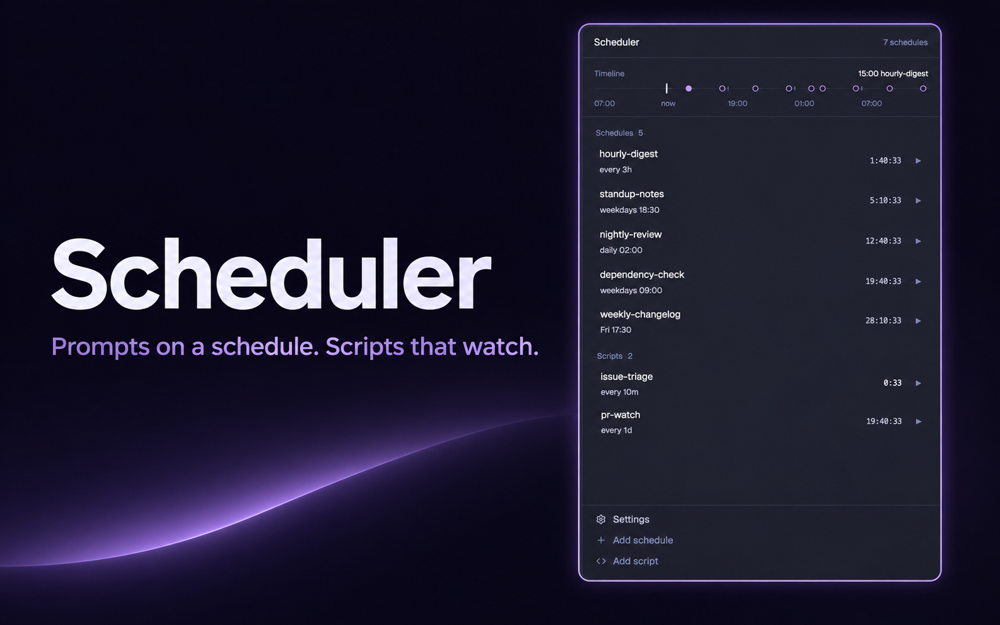
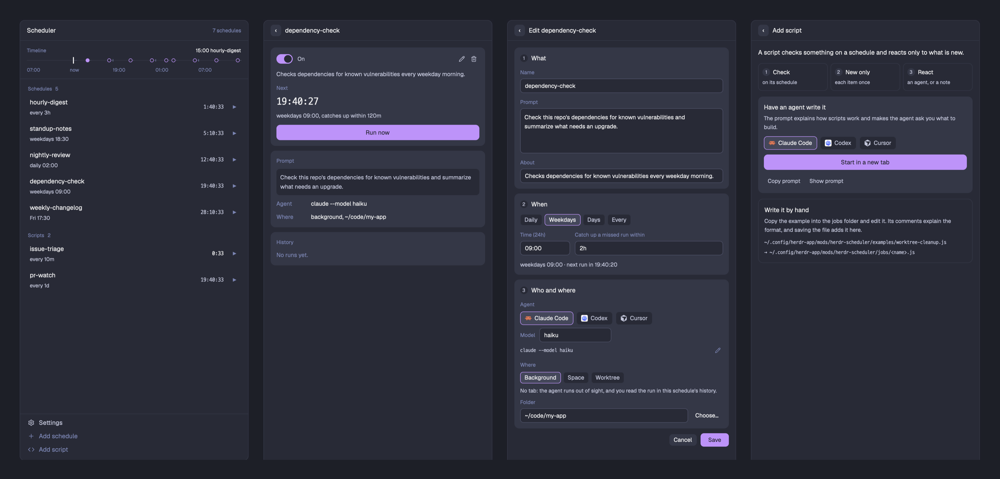

# herdr-scheduler

Prompts on a schedule and scripts that watch, for your coding agents, inside the
[Herdr](https://herdr.dev) app. One mod, one JS file per schedule: no daemon, no cron entry, no CLI.

[한국어](README.ko.md)



There are two kinds of things it runs:

- A **schedule** gives an agent a prompt at set times: every day at 09:00, on weekdays, on chosen days,
  every N minutes. You make one in the panel.
- A **script** is code that checks something at set times and reacts only to what is new: it starts an
  agent, continues an earlier agent's conversation, or only tells you. An agent writes it with you.



## What you get

- **A timeline.** One line shows the last six hours' results and the next twenty-four hours' runs.
- **Three places to run.** In the background with no tab at all, in a new tab of a space, or in a git
  worktree of its own. Nothing takes your window's focus when a run starts.
- **A form for schedules.** What the agent is told, when, and who runs it where. Pick an installed agent
  and a model; the form shows the next run as you type.
- **A prompt for scripts.** Add script hands an agent a prompt that explains how scripts work and makes
  it ask what you want built. Copy it, or start an agent with it in one click.
- **History you can open.** Every run is a row. A background run opens in a peek, a run in a tab is gone
  to, and an ended run's last screen is read back into the panel.
- **English and Korean.**

## How it differs from a daemon

The mod is the scheduler, so things run **while Herdr is open** with the Scheduler panel in the shown
layout. If your panel isn't always visible (a tab of a stack, for example), add a headless copy that only
runs them; [app/RECIPE.md](app/RECIPE.md) has the layout line. A run missed while Herdr was closed is
caught up when it opens, if the schedule says so. If you need runs with the app closed, use a
daemon-based tool instead.

## Install

In Herdr, ask your agent:

```
Read ~/.config/herdr-app/AGENTS.md, then add this mod: https://github.com/kimsuhan/herdr-scheduler/tree/main/app
```

Or by hand:

```sh
git clone https://github.com/kimsuhan/herdr-scheduler
cp -R herdr-scheduler/app/mods/herdr-scheduler ~/.config/herdr-app/mods/
```

The panel docks on the right the first time Herdr sees it. It needs `hc` (herdr-core) and, for worktree
runs, `git`.

## Schedules

Press **Add schedule** at the bottom of the panel. The form has three cards:

1. **What**: a name, the prompt, and an optional line saying what it is for.
2. **When**: daily, weekdays, chosen days or an interval, and how long after a missed time it may still
   run.
3. **Who and where**: the agent and its model, and the place.
   - Background: no tab. You read the run in the schedule's history.
   - Space: a new tab in a space you pick.
   - Worktree: a separate checkout of a repository in its own space, so the agent never touches your
     working folder. Either it starts from the latest code on every run, or it keeps a branch.

A schedule is one file, `jobs/<name>.js` in the mod's folder, so you can also write it by hand
(`examples/daily-prompt.js` is a commented one):

```js
// ~/.config/herdr-app/mods/herdr-scheduler/jobs/dependency-check.js
export default {
  about: "Checks dependencies for known vulnerabilities every weekday morning.",
  schedule: { weekdays: "09:00" },
  catchUp: "2h",
  where: { background: true, cwd: "~/code/my-app" },
  agent: ["claude", "--model", "haiku"],
  prompt: "Check this repo's dependencies for known vulnerabilities and summarize what needs an upgrade.",
};
```

| Field | Values |
|---|---|
| `schedule` | `{ daily: "09:00" }`, `{ weekdays: "09:00" }`, `{ days: [1, 3], at: "09:00" }` (0 = Sunday), `{ every: "30m" }` (`m`, `h`, `d`) |
| `about` | optional: a line shown on the schedule's page |
| `catchUp` | optional, `"2h"`: a run missed by less than this still runs. Without it a missed run stays missed |
| `where` | `{ background: true, cwd }`, `{ space: "<name or id>" }`, `{ worktree: { repo, commit } }` or `{ worktree: { repo, branch } }` |
| `agent` | the command to start, as an array |
| `prompt` | sent once the agent is ready |

Worktrees go to `~/.herdr/worktrees/<repo>/<schedule name>`, where Herdr's own worktree mod puts them.

A schedule doesn't start a new run while its last one is still working or waiting on you. Before a
background run, its earlier idle background agents are ended, so they don't pile up.

## Scripts

Press **Add script**. A script is code, so there is no form: the page gives you a prompt for an agent.
The prompt explains how scripts work and makes the agent ask what you want before it writes anything.
Copy it, or pick an installed agent and start it in a new tab.

A script is also one file in `jobs/`. On each of its times it runs a round: `poll` returns items, and
`handle` runs once for each item whose key it has not seen before.

```js
export default {
  about: "Starts an agent on each merged pull request.",
  schedule: { every: "5m" },
  async poll(ctx) { return [{ key: "pr-12@merged", thread: "pr-12" }]; }, // items; each key is handled once
  async handle(item, ctx) {
    const t = ctx.thread(item.thread);            // the terminal holding that thread, or null
    if (t) return ctx.send(t, "It was merged. Wrap up.");
    await ctx.start({ where: { background: true, cwd: "~/code/my-app" }, agent: ["claude"], prompt: "…", thread: item.thread });
  },
  async ended(thread, ctx) { return false; },     // optional: true lets the thread's terminal go
};
```

`ctx` has `exec`, `start`, `send`, `thread`, `notify`, `skip`, `state.get`/`state.set` (kept in Herdr's
shared state under `scheduler.state`, where other mods can read it), `spaces`, `panes`, `terminals` and
`home`. A script that starts agents handles one item at a time; the rest wait for a later round.
`examples/worktree-cleanup.js` is a commented script that marks worktree spaces whose pull request is
merged or closed.

In the panel a script can be run, paused and deleted, and its times and description can be changed. Its
code is changed in the file.

## Read before you run

A schedule starts a program with a prompt on your machine, and a script runs any code and any program it
calls. Read one before you put it in `jobs/`, and read what an agent wrote for you.

## The panel

- **Timeline**: left of now, a dot for each hour something ran (green, or red when a run failed); right
  of now, a ring for each hour something will run, filled for the next one.
- **List**: what is running or has gone wrong comes first, then schedules by next run, then scripts, then
  paused ones. Each row has a timer to its next run and how the last run went. `▶` runs it now.
- **A schedule's page**: a switch to pause it, edit and delete, the timer, Run now, what it runs, and
  its history with the last sixteen results as a strip.
- **Settings**, at the bottom: the language.

## Remove

Delete `~/.config/herdr-app/mods/herdr-scheduler` (your schedules and scripts are in its `jobs/`) and
the block from your layout.

## Development

See [AGENTS.md](AGENTS.md). [app/RECIPE.md](app/RECIPE.md) describes the mod in full.

## License

MIT
