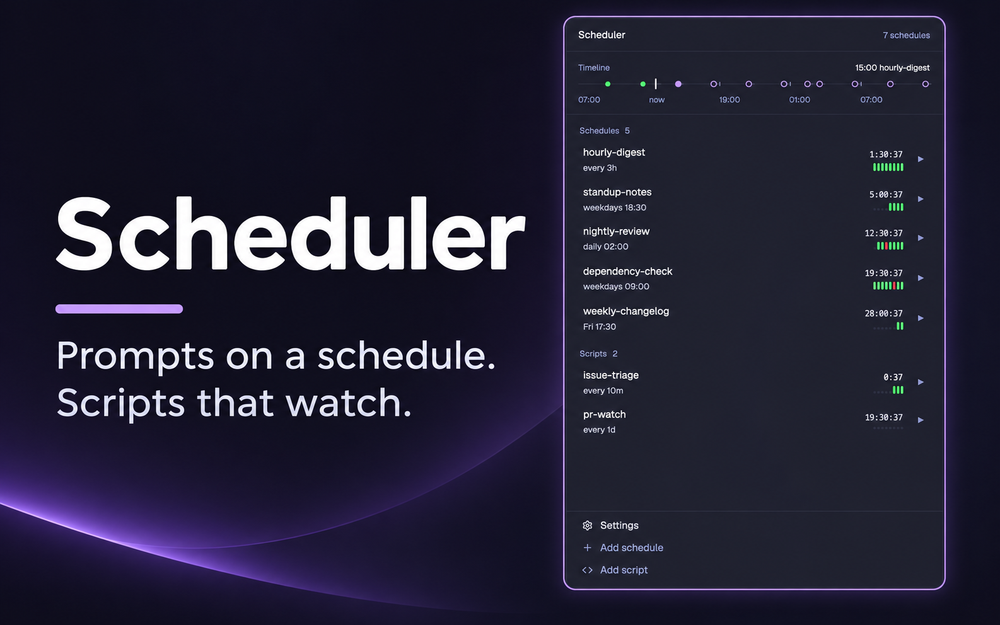

# Scheduler

A side panel for automations: recurring schedules that give a coding agent a prompt at set times (every
day at 09:00, weekdays, chosen days, every N minutes), in the background, in a new tab of a space, or in
a git worktree. A code schedule, which the panel calls a script, instead polls for items at its times and
handles each new one with its own code, which may start an agent or continue an earlier agent's
conversation. A schedule is one JS file in the
mod's `jobs/` folder, written by hand or by the panel's form; saving it is all the setup there is. The
panel lists the schedules with their next run, makes, edits, runs or pauses one, and keeps each one's history.
There is no daemon, cron entry or CLI: the mod is the scheduler, so schedules run while Herdr is open.



## Before you add it

The mod **runs programs**: `hc` to start each agent, wait for it, send its prompt, label it, read it
back and end it, and `git` (`fetch`, `worktree add`, `checkout --detach`, `rev-parse`) for worktree schedules.
Each schedule starts **the command its file names** with **the prompt its file holds**. A code schedule **runs
its own JavaScript** inside Herdr on every round, with **whatever programs it calls** through `ctx.exec`
(the example calls `gh`), and can start agents and type into terminals that hold its threads. Read a schedule
before putting it in `jobs/`. The mod reads the folder `~/.herdr/worktrees/<repo>/<name>` to see if a
checkout exists. It reaches no network itself (`git fetch`, the agents and a code schedule's programs do).
The only files it writes or deletes are the schedules in its own `jobs/` folder, when you save or delete one
in the form; its state is in Herdr's shared state under `scheduler.*`.

Schedules run only while Herdr is open and a copy of this mod has been shown once in the shown layout. A
panel that isn't always shown (a child of a stack, a pane in another tab) only starts when someone looks
at it: for those layouts add a second copy with `props: { headless: true }` in a floating block. It
draws nothing and runs the schedules:

```json
"floating": [{ "id": "scheduler-engine", "content": { "mod": "herdr-scheduler", "props": { "headless": true } }, "edge": "bottom", "align": "end" }]
```

## What you see

A card filling its block: `rounded(10)`, 1px `border`, `background`, 13px text in `foreground`.
Top to bottom:

- **Header**, 42px, 14px side padding, 1px `border` below: "Scheduler" semibold on the left, and on the
  right "N schedules" (11px, `dim`). In a schedule's detail, the form or the settings it shows a 24px
  "‹" button and the schedule's name, "New schedule" or "Edit <name>".
- **Timeline**, at the top of the list: 14px side padding, 1px `border` below. A title row, "Timeline"
  (10.5px semibold `dim`) and at the right the next run on the line in `foreground`, "15:00
  hourly-digest" ("+2" after it when two more run in that hour). Under it one 14px line of 30 equal
  cells, an hour each: the last six hours, the current hour, the next twenty-three. The line is 1px,
  `border` in the past and `input` from now on. Now is a 2px by 14px `foreground` bar. Left of it a 6px
  dot in each hour something ran: `ansi2`, or `ansi1` when a run in it failed, was missed or was
  interrupted. Right of it an 8px `accent` ring in each hour schedules run, filled for the next one. A
  1px by 5px `dim` tick every six cells, and under the line five 10px `dim` labels: the clock time at
  each tick ("06:00", "18:00") and "now". A dot's tooltip lists the times and names. Schedules that
  run more than hourly, and paused or broken ones, have no rings.
- **Schedule list**, scrolling, in up to five sections in this order: Running (working or blocked),
  Needs attention (broken, failed, missed, interrupted), Schedules (prompt schedules, soonest first),
  Scripts (code schedules, by name), Paused. A section's
  name and count (10.5px semibold `dim`) show only when more than one section has rows. One row per
  file in `jobs/`: 8px side margin, 10px left and 8px right padding, 10px gaps, `rounded(8)`, a 2px
  left border, `hover` background on hover:
  1. the name (13px medium, truncated) over one 11px `muted` line with the schedule only, "weekdays
     09:00", "every 5m" (where it runs and its `about` are on its page); when the file is broken or the
     last run failed, that line is the reason in `ansi1`;
  2. right-aligned: the time left as a timer in the terminal font, 12px (`foreground` in its last hour,
     else `muted`), "20:37:40", "2:40", or the state's word in its color in place of the timer; under
     it a strip of its last eight runs, oldest at the left: a 3px by 10px bar per run (`ansi2` when it
     is done or handled, `ansi1` when it failed, was missed or interrupted, the state's color while it
     is going, else `dim`) and a 3px `border` dot for each slot with no run yet. A code
     schedule's row reads the same; what its last round found is on its page;
  3. a 24px "▶" with no frame (`dim`; `raised` background and `foreground` on hover). While the schedule
     is running (see "▶" and "Run now" below) it is a braille spinner (`.frames`, 90ms, 13px `working`)
     that can't be pressed.
  A schedule in a state (running, blocked, paused, gone wrong) has a `raised` background and its left
  border in the state's color; the others are plain, with the border in `background`. A broken file
  has only the name and the reason.
- **Empty**: "No schedules yet." and how to make one with "Add schedule" or copy one from `examples/` to `jobs/`.
- **Footer**, on the list only, drawn like the two rows at the foot of Herdr's sidebar: 1px `border`
  above, padding 8px sides, 4px top, 8px bottom; three 28px rows (`rounded(8)`, 8px padding, 9px gap, a
  14px icon then the label in 13px; `hover` background and `foreground` on hover): a gear and "Settings"
  in `muted`, a plus and "Add schedule" in `dim`, code brackets and "Add script" in `dim`.
- **Add script** (after clicking it), 14px padding, 12px gaps, top to bottom:
  - one 13px line: "A script checks something on a schedule and reacts only to what is new.";
  - three equal boxes in a row (1px `border`, `rounded(8)`, 8px padding): a 16px round `raised` chip with
    the number, a 12px medium word, and a 10.5px `muted` line under it: 1 "Check" / "on its schedule",
    2 "New only" / "each item once", 3 "React" / "an agent, or a note";
  - a `raised` card (`rounded(10)`, 12px padding): "Have an agent write it" (13px medium) over an 11.5px
    `muted` line; a 28px pill per installed agent with its program icon (`selected` with an `accent`
    border when picked, else `background`); a full-width 32px `solid` button "Start in a new tab"; two
    quiet text buttons, "Copy prompt" ("Copied" once pressed) and "Show prompt" / "Hide prompt", which
    unfolds the prompt in a 220px scrolling `background` box, 11px in the terminal font. With no agent
    installed the pills and the button are absent;
  - a bordered card: "Write it by hand" over an 11.5px `muted` line, then two lines in the terminal
    font, the example file's path and "→ …/jobs/<name>.js".
- **Settings** (after clicking "Settings"): the header's "‹" and "Settings"; a "Language" label (11px
  semibold `dim`) over two pills, "English" and "한글".
- **Detail** (after clicking a row), 14px padding, 10px gaps: three `raised` cards (`rounded(10)`, 12px
  padding), each with an 11px semibold `dim` caption.
  1. A top row: a pill switch (34px by 20px, `accent` with the 16px `background` knob at the right
     when on, `input` with the knob at the left when paused) and beside it "On" or "Paused" (11.5px);
     at the right a 24px pencil (tooltip "Edit") and a 24px bin (tooltip "Delete"; after one click it
     turns `ansi1` and says "Really delete" beside it). Then the schedule's `about` line if it has one
     (12px `muted`); "Next" over the timer to the next run,
     22px in the terminal font, or "Status" over the state's word in its color, 20px medium, while it
     is running, blocked, paused or gone wrong; under it the schedule in 11.5px `muted`, "daily 09:00,
     catches up within 120m"; a full-width 32px `solid` "Run now" (while the schedule is running: at 0.6
     opacity, the same spinner and "Running", not pressable); and "Changed in
     the panel: the file has other values." (11px `dim`) for a changed script.
  2. "Prompt": the prompt in a `background` box (12px `muted`), then Agent and Where lines (64px `dim`
     label, value truncated). For a code schedule "Runs" instead: Runs, "code: poll, handle" (", ended"
     when it has one), and Checked, "2m ago: 3 items, 0 new" ("failed" when the round threw, "not
     since the last reload" before its first).
  3. "History", and at its right the last sixteen runs as the same strip of bars as on the list; then one row per run, newest first: a 6px dot
     and the state's word in its color (64px), the item's key and the note or else the trigger, and
     when. "No runs yet." when there are none.
  A broken file's page is one card: "Needs attention" with the pencil and the bin at its right, over
  the error in `ansi1`.
- **Form** ("Add schedule" or "Edit"), 14px padding, 10px gaps: three `raised` cards (`rounded(10)`,
  12px padding), each headed by a 16px round `background` chip with its number and a 13px medium title.
  Inputs are 30px (`rounded(7)`, 1px `input` border, `background`); labels are 11px semibold `dim`;
  pills are 24px (`selected` with an `accent` border when on, else `background`).
  1. "What": Name, Prompt (a text area, 4 to 12 lines), About.
  2. "When": Repeat pills Daily, Weekdays, Days, Every; day pills Mo to Su for Days; side by side Time
     (104px wide; Interval for Every) and "Catch up a missed run within"; under them in 11.5px `muted`
     what it comes to as it is typed, "weekdays 09:00 · next run in 19:58:12" (absent while invalid).
  3. "Who and where": Agent, a 28px pill per installed agent with its program icon. With one picked:
     "Model" beside a 150px input (placeholder "default model"), then the command that comes of it as
     11px `muted` text in the terminal font, "codex --no-daemon --model gpt-5", and at its right a 22px
     pencil button (tooltip "Edit the command"). The pencil turns the text into the command input, for
     a command of the person's own; picking a pill goes back. A saved command that isn't a known
     agent's with at most `--model <x>` after it opens as the input; Where pills Background, Space, Worktree, and under them one 11px `muted`
     sentence saying what the picked place is. Background: "Folder" over an input and "Choose…".
     Space: a pill per space on this machine. Worktree: "Repository" over an input and "Choose…";
     "Code to start from" over two pills, "Latest every run" (the file's `commit`) and "Keep a branch"
     (`branch`), with a sentence on what the picked one does; "Branch or commit to check out" or
     "Branch name" over an input; and the checkout's path in 10.5px `dim` terminal font,
     "~/.herdr/worktrees/<repo>/<name>".
  Under the cards a red line saying what is wrong, only once Save was pressed with something wrong; then
  Cancel and a `solid` Save at the right ("Reset to the file" at the left for a changed script). A
  script's form has card 1 with About only, card 2 without the catch-up field, and in place of card 3
  the same agent card as the Add script page, titled "Change its code": the agent pills, "Start in a
  new tab", "Copy prompt" and "Show prompt".

## How it behaves

- A row's left border and the word in place of its timer say what a schedule is doing: `working` color and "running" while its agent
  works, `blocked` color and "blocked" while it waits on the person, `dim` and "paused", `ansi1` and
  "failed", "missed" or "interrupted" when the last run went wrong, `ansi1` and the error when the file
  is broken, otherwise `idle`. The state's word takes the timer's place; with no word the timer counts
  down every second, `h:mm:ss` or `m:ss`. The detail's Next line shows the same timer.
- Clicking a dot on the timeline opens the first schedule that ran or runs in that hour.
- Every 5 seconds each schedule's current slot (the latest scheduled time that has passed) is compared with
  the last slot seen. A new slot runs if it is at most 90 seconds old, or at most `catchUp` old when the
  schedule sets one (trigger "catch-up"); older than that it becomes a "missed" row. A schedule seen for the first
  time doesn't run until its next slot. A slot is skipped without a row while the schedule is paused or it is
  running.
- A run starts the agent with `hc run --bg --no-parent`, waits until it reports idle, then sends the
  prompt with `hc send`. Nothing takes the window's focus.
  - `background`: no pane anywhere.
  - `space`: a new tab in that space, started in the folder of the space's first pane.
  - `worktree`: a space on `~/.herdr/worktrees/<repo folder name>/<name or schedule name>`, made if absent.
    With `commit` the repo is fetched and the checkout detached at it on every run; with `branch` (default:
    the name) the branch is created from the repo's HEAD if new and left alone afterwards. If a space
    already shows that folder, the run is a new tab in it.
- A run that can't start (no such space, git error, an agent that asks something before the prompt or
  isn't ready in 2 minutes) is a "failed" row with the reason, and an error notification.
- A round that finds nothing new leaves no history row, so the panel keeps what each code schedule's last
  round found (how many items `poll` returned, how many were new) in memory and shows it as "checked".
  A reload forgets it until the next round.
- A code schedule's slot runs one round instead of a run. A late slot simply runs (no "missed" rows, no
  catch-up), and a busy schedule still runs its rounds. Two rounds of one schedule never overlap. A round:
  1. If the schedule has `ended`, it is called for each live terminal labelled `scheduler.thread=<name>:<thread>`;
     when it returns true the label is removed (`hc label <t> scheduler.thread=`).
  2. `poll` returns items. Nothing counts as none; anything but an array, or an item without a `key`, is
     a failure. Keys are made strings.
  3. Each item in order: the round stops if the schedule is busy (a live terminal labelled with the schedule or one
     of its threads is working or blocked); an item whose key is in
     `scheduler.seen` is passed over; otherwise its key is written there (before anything is awaited)
     and `handle` runs. The round also stops after an item whose `handle` gave an agent work
     (`ctx.start` or `ctx.send`), since the agent may not report working yet. Items it didn't reach come
     back in a later round.
- Each handled item is a row (trigger "poll", the key in `item`), "running" while `handle` runs. When it
  returns the row follows the terminal `ctx.start` or `ctx.send` gave it, like a prompt run's, or reads
  "handled"; `ctx.skip` makes it "skipped" with the reason; a throw makes it "failed" with the message and
  an error notification "<schedule> failed on <key>".
- A `poll` or `ended` that throws ends the round. It is a "failed" row (trigger "poll") and an error
  notification "<schedule> failed", unless the schedule's newest row is already "failed" with the same message.
- History states: starting, running, blocked, done (the agent is idle again; for a background run, ended with its turn over), ended (its terminal is
  gone, or a later item's `ctx.send` took it), failed, missed, interrupted (a start or a `handle` cut off by a
  reload: a "starting" row whose schedule isn't running in this JS thread), handled, skipped.
- "▶" and "Run now" start the schedule at once, paused or not: a code schedule runs a round. A schedule is
  running from that press (or its slot) until its run has got its prompt or its round is through (kept in
  memory, so a reload ends it), and also while it is busy; meanwhile the row reads "running" and neither
  starts it again. Turning the switch off stops
  scheduled runs and rounds of that schedule.
- The form checks what is typed as it is typed. Pressing Save with something wrong shows the first
  problem and saves nothing; from then on the line follows what is typed. Save writes `jobs/<name>.js` as `export default { … };` (JSON), which reloads the mod
  and brings the list back with the schedule in it. A name can't be one that is there. It is the file's name and goes into
  terminal labels, so it may be any text (Korean, spaces) without `/`, `\`, `:` or `=` and not starting
  with a dot. Changing the name
  in "Edit" moves the file (the new one is written, then the old one removed) and moves what shared
  state keeps under the old name (slots, pause, seen keys, state, history rows), so the history stays.
  For a code schedule, whose file has functions and can't be written back, "Edit" opens
  a short form: About, Repeat and its time or interval only. Saving it writes no file: the values go
  to shared `scheduler.overrides` and are laid over the file's in every copy at once, the detail then
  says "Changed in the panel: the file has other values.", and the form gains "Reset to the file",
  which drops them. The bin asks once ("Really delete"),
  then removes the file. "Choose…" opens the system's folder picker.
- "Copy prompt" puts the prompt on the clipboard. "Start in a new tab" opens a tab named "New script"
  in the shown space, in Herdr's home folder, running the picked agent with the prompt as its first
  message, and closes the page. This is the one place the mod takes focus, since the person is about
  to talk to that agent. The prompt is English whatever the panel's language, and tells the agent to
  talk in the panel's language: it says where the examples and `jobs/` are, what a script is and may
  use, to run `herdr-app check` afterwards, and above all to ask what the script should do before
  writing anything, because the panel can't know that.
- A script's form hands an agent a prompt of its own for changing the code. It names the script's file
  and tells the agent to read it, say what it does now and ask what should change before editing
  anything; to change only that and keep the file's name; to warn before a change to the keys `poll`
  returns, since every item still there would be handled again; to send a change of times or
  description back to the panel's Edit; and to run `herdr-app check` and say what the next round will do
  differently. Its tab is named "Edit <name>".
- Picking a language sets shared `scheduler.lang` (`en` or `ko`; unset is English) and every copy of the
  panel redraws in it at once: labels, buttons, states, "5m ago" times ("5분 전"), schedules ("평일
  09:00", "5분마다"), validation and start failures, and notifications. Names, prompts, `about` lines,
  item keys and a program's own error output stay as they are. History notes are stored in English and
  translated when shown.
- Clicking a history row with a terminal (one still starting too, so a dialog the agent stopped at can be
  seen): a background run still alive opens in a peek (`terminal.peek`); a run in a
  tab is gone to (`pane.focus`); an ended run's last 200 lines are read back and shown under the row in
  the terminal font (click again to fold).
- A background agent is ended as soon as its turn is over, on the next tick: it has no tab, so left
  alive it is a program holding memory that nobody sees. Its row is marked "done" first and its last
  screen stays readable from the history. One that is blocked (waiting on the person) stays, and so
  does one holding a thread, whose conversation is continued. Of a schedule's ended background
  terminals only the newest 5 are kept (`hc rm` for the rest, before its next background run).
- The same tick ends the idle background agents of schedules that no longer exist, and removes their
  terminals. Renaming a schedule relabels its live terminals, so they stay its own.
- A schedule whose file is gone takes its history, seen keys, state and pause with it on the next tick
  (unless no schedule is left at all: an unreadable `jobs/` looks the same).
- Saving a file in `jobs/` reloads the mod: the list follows at once and nothing runs, ends or is
  dropped for the next 30 seconds, so a run of saves doesn't start runs that the next save cuts off. A
  tidy whose `hc` calls are still going when the next tick comes is not started again.

## Built from

- One mod, `mods/herdr-scheduler/`, `mod.json` `{ "place": "right", "size": 340 }`. One optional prop,
  `headless: true`: that copy renders an empty `div()` and only runs the schedules. No layout, no keys, no
  shipped mods. Art: `settings.svg`, `plus.svg`, `script.svg`, `pencil.svg` and `trash.svg` (Lucide's settings, plus, code, pencil and trash-2 icons: 24px,
  stroke 2, `currentColor`), drawn with `svg("mods/herdr-scheduler/<name>.svg")` so they take the text color.
- `schedule.js`, pure: `duration("2h")`; `parse(schedule)` to `{ every: ms }` or `{ days, at: minutes }`;
  `slot(p, now)` and `next(p, now)` (`every` is counted from the epoch, times of day are local);
  `due(p, last, now, grace)`; `describe(p)`; `items(list)` (a poll's result checked); `remember(seen,
  key, now, cap = 500)` (the seen keys with one added, the oldest dropped past the cap).
  `schedule.test.js` covers them with `node --test`.
- `i18n.js`, pure: `LANGUAGES`; `say(lang, key, ...args)`, where the English text in the code is the key
  and `{0}`, `{1}` are filled in. A language is a map from key to text plus patterns for messages with a
  value inside (`"25:00" is not a time (09:30)`, `every 5m`). `main.js` and `engine.js` wrap it as
  `L(key, ...args)`. `i18n.test.js` scans the code for every `L("…")` key and every plainly thrown
  message and fails if a language lacks one.
- `engine.js`: `load()` reads `jobs/` with `fs/promises` `readdir` and imports each file with
  `import(["./jobs/", file].join(""))`; `tick(bots)` returns what to start; `start(bot, trigger)` (a run,
  or a code schedule's round); `state(row)`; `busy(name)`; `where(w)`; `tidy(bots)` (ends background agents that are through); `lastRound(name)` (what a code schedule's
  last round found, kept in a module-level object); `setPaused(name, on)`; `check(bot)` (a code schedule
  checks to `{ schedule, code: true }` and is called through its file's object, so `this` works);
  `save(name, bot, fresh)` and `remove(name)` with `fs/promises` `exists`, `mkdir`, `writeFile`, `unlink`.
- `prompt.js`, pure: `scriptPrompt(dir, language)`, the text the Add script page shows, copies and sends,
  and `editPrompt(dir, name, language)`, the one a script's form does.
- `main.js`: the `View`, `cx.timer.every(30000)` for the engine and `cx.timer.every(1000)` to redraw the
  timers (not in the headless copy), the list, detail and form (`InputState`, `Input`,
  `TextareaState`, `Textarea` from `gpui-base`).
- A schedule file default-exports:
  ```js
  export default {
    about: "…",                        // optional: a line shown on the schedule's page (code schedules too)
    schedule: { weekdays: "09:00" },   // { daily } | { days: [1, 3], at } (0 = Sunday) | { every: "30m" }
    catchUp: "2h",                     // optional
    where: { background: true, cwd: "~/code/my-repo" },
                                       // { space: "<name or id>", cwd? } | { worktree: { repo, commit | branch, name? } }
    agent: ["claude", "--model", "haiku"],
    prompt: "…",
  };
  ```
  or a code schedule (`examples/worktree-cleanup.js`):
  ```js
  export default {
    schedule: { every: "5m" },
    async poll(ctx) { return [{ key: "…", thread: "…" /* optional */, ...data }]; },
    async handle(item, ctx) { … },
    async ended(thread, ctx) { return true; },   // optional
  };
  ```
- `ctx`, the only API a code schedule gets (it never imports `herdr`):
  - `exec(cmd, args, { cwd, timeout })`: herdr's `exec`. `notify({ title, body, level })`. `spaces()`,
    `panes()`, `terminals()`: herdr's, as they are. `home`: the home folder.
  - `state.get(key)`, `state.set(key, value)`: the schedule's store in `scheduler.state`; `set` writes only
    when the value changes, and `undefined` removes the key.
  - `thread(name)`: the address of the live terminal labelled `scheduler.thread=<name>:<name>`, or null.
  - `skip(item, why)`: in `handle` the item's row becomes "skipped" with `why`; elsewhere a new
    "skipped" row.
  - In `handle` only (elsewhere they throw "ctx.start works in handle only"):
    `start({ where, agent, prompt, thread? })`, checked like a prompt schedule's and started the same way, plus
    the label `scheduler.thread=<name>:<thread>`; resolves with the address, rejects with the reason.
    `send(terminal, text)`: `hc send <t> <text>` (rejects if it fails), then `hc label <t>
    scheduler.run=<the item's row>`.
- `herdr`: `hc`, `exec` (git), `appHome`, `home`, `shared`, `setShared`, `terminals`, `spaces`, `panes`,
  `notify`, `run`, `theme`, `settings`, `pickFolder`, `props`, `knownAgents`. Commands: `terminal.peek`,
  `pane.focus`, `tab.new {name, folder, argv, task}`. `cx.write_to_clipboard(text)` copies.
- `hc`: `run --bg --no-parent --json --cwd <dir> --label … -- <agent>`, `wait <t> --timeout 20 --json`,
  `send <t> <prompt> --if idle --json`, `send <t> <text>` (`ctx.send`), `label <t> k=v`, `read <t> --lines
  200`, `kill <t>`, `rm <t>`.
- Labels on every run's terminal: `scheduler.bot=<name>`, `scheduler.run=<id>`; runs in a tab also get
  `herdr.space=<id>` and `herdr.tab=tb<32 hex>`, which is what puts them there. A code schedule's thread:
  `scheduler.thread=<name>:<thread>`, which a person may also put on a terminal by hand.
- Shared state: `scheduler.slots` `{ name: ms }`, `scheduler.paused` `{ name: true }`, `scheduler.next`
  `{ name: ms }` (for other mods), `scheduler.history` (rows `{ id, bot, at, trigger, where?, status,
  item?, terminal?, note?, removed? }`, newest first, 50 per schedule), `scheduler.seen` `{ name: { key: ms } }`
  (500 per schedule), `scheduler.state` `{ name: { key: value } }` (for other mods), `scheduler.lang`, `scheduler.overrides`
  `{ name: { schedule, about } }` (what the panel changed of a code schedule).

## Watch out

- Herdr only imports files inside the mod folder (no absolute paths, no `data:` URLs, no `new
  Function`), which is why schedules live in `jobs/` and the import path is built at run time.
- A prompt passed in the agent's argv is typed but not sent. Start the agent bare, wait, then `hc send`.
- `tab.new` and `space.new` take the window's focus. The `herdr.space` and `herdr.tab` labels don't,
  and an id Herdr doesn't know becomes a new space or tab.
- Several copies of the mod share one JS thread: write the slot to `scheduler.slots`, and an item's key
  to `scheduler.seen`, in the same synchronous stretch that read it, before any `await`, or two copies
  start the same run or handle the same item.
- Right after `hc send` an agent may still report idle, so a busy check alone lets a round hand out a
  second item at once: stop after an item that gave an agent work.
- A thread's terminal must survive the schedule's next background start: the cleanup skips terminals with a
  `scheduler.thread` label, and `ended` is what lets them go.
- Every `setShared` redraws every mod. Write `scheduler.slots` and `scheduler.next` only when they
  differ from what is there.
- A save in the mod's folder reloads it, so the only writes are the form's, and state never goes there.
- A schedule's seen keys go with its file: move a code schedule out of `jobs/` and back, and items still returned
  by its `poll` are handled again.
- The headless copy relies on a floating block's mod starting although it draws nothing.
- The form splits the agent command on spaces. A script can't be renamed in the panel: its name is in
  its threads' labels and may be what other mods read. Editing a hand-written file through it
  drops its comments.
- A program that never reports a status (a plain shell as `agent`) is never "ready": the run fails after
  2 minutes. Schedules are for agents.
- `hc rm` only removes ended terminals; history rows remember which they removed.
- It assumes `hc` and `git` on the PATH Herdr uses, and spaces on this machine only.
- A new string in the panel needs its text in every language of `i18n.js`, or it shows in English; the
  test catches a missing one only when the string is written as `L("…")`.
- Not built: pause all, editing a code schedule's code or making one in the form, `ctx.start`/`ctx.send` outside `handle`, running
  one item at once (only a whole round), forgetting a seen key except by the 500 cap.

## Done when

- `node --test mods/herdr-scheduler/schedule.test.js mods/herdr-scheduler/i18n.test.js` passes and `herdr-app check mods/herdr-scheduler` passes.
- With `jobs/` empty the panel says "No schedules yet."; copying `examples/daily-prompt.js` in lists it with
  its schedule and a timer counting down within a second.
- A file with `daily: "25:00"` shows `"25:00" is not a time (09:30)` in red and the other schedules keep working.
- A schedule on `{ every: "1m" }` with `where: { background: true }` and a Claude agent gets its prompt
  answered within two minutes, with no new tab and the focused pane unchanged; its history row reads
  "done", and the next run ends the first one's agent.
- The same schedule with `where: { space: "<a space's name>" }` adds a tab to that space, and with
  `where: { worktree: { repo, branch } }` makes the checkout and a space on it; neither takes focus.
- Turning the switch off stops the runs and shows "paused"; turning it on brings the timer back.
- "Settings" at the bottom of the list opens the settings; picking 한글 turns the whole panel Korean at
  once ("스케줄러", "스케줄 3개", "평일 09:00"), and English turns it back.
- "Add schedule" with a name, Daily 09:00, Background and a prompt saves `jobs/<name>.js` and the schedule is in the list;
  a time of 25:00 shows the problem and Save does nothing; the bin pressed twice removes the file and the row.
- A code schedule on `{ every: "1m" }` whose `poll` returns fixed items lists as "code"; each new key is
  handled once across rounds; an item whose `handle` calls `ctx.start({ where: { background: true },
  agent, prompt, thread })` gets its prompt answered and the terminal carries `scheduler.thread`; a later
  item on that thread finds it with `ctx.thread` and `ctx.send` continues the same conversation; the next
  item after one that started or sent waits for the next round; `ended` returning true removes the
  label; a `poll` that throws makes one "failed" row, not one per round; `ctx.state.set` shows under
  `scheduler.state`.
